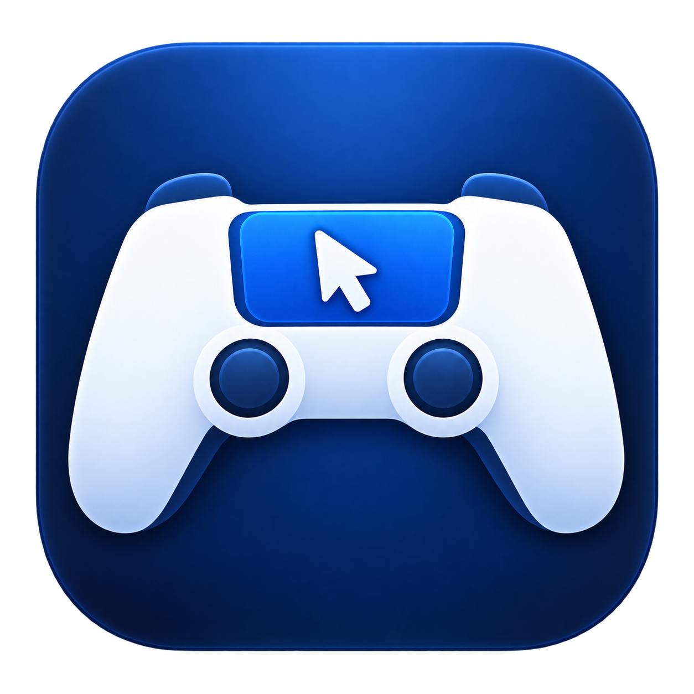

<p align="center">
  
</p>

<h1 align="center">DS4Mouse</h1>
<p align="center"><strong>Your PS4 controller already has a trackpad. Put it to work.</strong></p>
<p align="center">A native Mac menu bar app that turns a Bluetooth DualShock 4 touchpad into a mouse.</p>
<p align="center">
  <a href="https://github.com/vivs999/DS4Mouse/actions/workflows/ci.yml"></a>
  <a href="LICENSE"></a>
  
</p>
<p align="center"><a href="#get-started">Get started</a> · <a href="#make-it-yours">Customize</a> · <a href="#the-cli">CLI</a> · <a href="#compatibility">Compatibility</a> · <a href="#troubleshooting">Troubleshooting</a></p>

Move the pointer, tap to click, scroll with two fingers, and hold the touchpad button to drag. Turn mouse control on or off from the menu bar or the command line. Remap gestures and controller buttons without leaving the app.

**Free and open source.** No account, subscription, analytics, or runtime downloads. DS4Mouse runs locally and has no third-party runtime dependencies.

> **Development preview:** [Download the Apple silicon DMG](https://github.com/vivs999/DS4Mouse/releases/tag/v0.2.0-preview.1). It is ad hoc signed and **not notarized**; macOS may block it. See the installation notes below before downloading. Source builds are also available.

## What it does

- **Familiar touch controls.** One-finger movement and taps, two-finger taps and scrolling, and physical-button dragging.
- **A feel you can adjust.** Tune pointer speed, swipe acceleration, scroll speed, and scroll direction.
- **Your own mouse mappings.** Assign controller buttons to clicks, holds, double-clicks, back/forward clicks, or wheel steps.
- **A small menu bar presence.** A transparent controller icon, a quick enable switch, and a native settings window.
- **GUI and CLI together.** Changes from either interface save automatically and apply to the running app.
- **Built for local use.** Native Swift, IOKit controller input, CoreGraphics mouse output, and a private per-user control socket. No kernel extension installation.

## Get started

### Download the app

Download the DMG from [Releases](https://github.com/vivs999/DS4Mouse/releases), open it, and drag DS4Mouse into Applications. Quit any existing copy first and keep only one installed copy so permissions apply to the app you use. The preview download is for **Apple silicon**.

This preview is ad hoc signed, without Developer ID signing or Apple notarization. If macOS blocks launch, review the message in **System Settings → Privacy & Security** and use **Open Anyway** only if you trust this project. Some systems or managed Macs may refuse this preview; building from source is the alternative. Do not disable Gatekeeper globally. Downloaded installation on a separate Mac has not yet been validated.

The CLI is inside the app. For an installation in `/Applications`, run:

```sh
/Applications/DS4Mouse.app/Contents/MacOS/ds4mouse help
```

Optionally create a user-local shortcut, provided that path is unused:

```sh
mkdir -p ~/.local/bin
ln -s /Applications/DS4Mouse.app/Contents/MacOS/ds4mouse ~/.local/bin/ds4mouse
```

Add `~/.local/bin` to your PATH to use `ds4mouse` directly.

### Build from source

You need a DualShock 4, Bluetooth, and an Apple Swift 6 toolchain with the macOS SDK. Install Xcode or Apple's Command Line Tools before building.

```sh
git clone https://github.com/vivs999/DS4Mouse.git
cd DS4Mouse
./scripts/build-app.sh
./scripts/install.sh
```

The installer places the app in `~/Applications/DS4Mouse.app`, creates `~/.local/bin/ds4mouse`, and opens the app. It refuses to overwrite an existing installation or CLI entry. Add `~/.local/bin` to your PATH if you want to use the short CLI command.

### Pair and enable

1. **Pair your controller.** Hold **SHARE + PS** until the light bar flashes, then connect it in macOS Bluetooth settings.
2. **Open DS4Mouse Settings** from its controller icon in the menu bar.
3. **Allow mouse control** with the button in General. On macOS 27, the permission is named **Device Control and Data Access**; earlier macOS versions call it **Accessibility**. Authorize the installed copy of DS4Mouse.
4. **Enable mouse control.** Mouse control starts disabled each time the app launches. If macOS needs a restart after a permission change, quit and reopen DS4Mouse, then enable it again.

If macOS blocks controller input, General also offers an **Input Monitoring** shortcut. Permission prompts and settings shortcuts disappear once their requirements are satisfied; working controller input is recognized even when a separate Input Monitoring grant is unnecessary.

To try the build before installing:

```sh
open dist/DS4Mouse.app
dist/DS4Mouse.app/Contents/MacOS/ds4mouse on
```

### Default controls

| On the controller | On your Mac |
| --- | --- |
| Move one finger | Move the pointer |
| Tap with one finger | Left-click |
| Tap with two fingers | Right-click |
| Move two fingers | Scroll |
| Hold the touchpad button and move | Drag |

Other controller buttons start unassigned. DS4Mouse adds mouse input without suppressing the controller input that games receive, so disable it whenever that extra mouse input would get in the way.

## Make it yours

Open **Settings → General** to tune movement and scrolling. Open **Mappings** to change gestures and button actions.

**Pointer speed** scales movement at every swipe speed. **Acceleration** makes faster swipes travel farther while keeping slow movement more precise. Acceleration ranges from **0–3**; **0** gives constant sensitivity and is the default. Existing settings from before acceleration was added also load with acceleration off.

```sh
ds4mouse set pointer-speed 1.5
ds4mouse set pointer-acceleration 1.0
ds4mouse set scroll-speed 0.8
ds4mouse set scroll-direction natural
```

For example, use Cross as a held left mouse button, Circle as right-click, and the shoulder buttons for browser navigation:

```sh
ds4mouse map button-cross hold:left
ds4mouse map button-circle right-click
ds4mouse map button-l1 back-click
ds4mouse map button-r1 forward-click
ds4mouse map two-finger-move scroll
ds4mouse mappings
```

Mappings are mouse actions only. Keyboard shortcuts and analog-stick control are not implemented.

## The CLI

```sh
ds4mouse on                 # Enable; launches the app if needed
ds4mouse off                # Disable and release held mouse buttons
ds4mouse toggle             # Switch enabled state
ds4mouse status --json      # Connection, permission, and readiness
ds4mouse doctor --json      # Detailed permission and configuration checks
ds4mouse help               # Commands and supported values
```

The CLI talks to the same app that owns controller input. `status` and `doctor` do not launch the app or request permission. Enabling control can request missing native mouse-event permission once per launch.

| Exit code | Meaning |
| --- | --- |
| `0` | Success |
| `2` | Invalid command or configuration |
| `3` | Service unavailable or a transport failure |
| `4` | Enabled, waiting for a controller or permission |

### Save and share a setup

```sh
ds4mouse config export ~/Desktop/ds4mouse-config.json
ds4mouse config import ~/Desktop/ds4mouse-config.json
ds4mouse config reset
```

Settings live at `~/Library/Application Support/DS4Mouse/config.json`. Export refuses to overwrite a file without `--force`. Reset backs up the previous configuration. Invalid configuration files are preserved and reported, so you can recover them.

## Compatibility

| Device or platform | Status |
| --- | --- |
| DualShock 4 revision 2 over Bluetooth | Hardware-tested: movement, taps, scrolling, and dragging |
| Apple silicon on macOS 27 | Tested locally |
| DualShock 4 revision 1 | Device matching implemented; hardware testing needed |
| macOS 13+ | Build deployment target; earlier macOS versions have not been validated |
| Intel Macs | Not yet tested |
| USB connection, DualSense, other controllers | Outside the current supported scope |

See the [verification record](docs/VERIFICATION.md) for the exact test environment and remaining checks, including reconnecting during a drag, sleep/wake, and multiple monitors. A passing build does not establish compatibility with every Mac or controller.

## Troubleshooting

**Connected, but the pointer does not move?** Run `ds4mouse doctor --json`. Check `enabled`, `permissionGranted`, `ready`, and `validReports`. Its diagnostics identify the exact running app path and separate mouse-event permission from controller-input access.

**Permission is switched on, but the app still reports it missing?** Confirm that the permission belongs to the installed app. Remove a stale DS4Mouse entry, add your installed copy (`/Applications/DS4Mouse.app` for DMG installs or `~/Applications/DS4Mouse.app` for source installs), enable it, then quit and reopen the app. The permission's name on macOS 27 is **Device Control and Data Access**.

**Permission disappears after a local update?** Ad hoc signatures identify a particular build. Local builds use an available Apple Development certificate to keep identity stable across updates. Choose a specific identity with `DS4_LOCAL_SIGN_IDENTITY`, or use `-` to force ad hoc signing. Without a development certificate, the build falls back to ad hoc signing and warns that permission may need renewal. Development signing does not make a build notarized.

**No controller reports?** Confirm the controller is connected over Bluetooth and check Input Monitoring if input is blocked. Close conflicting remappers. For a controller-only diagnostic that does not move the pointer:

```sh
swift run DS4Probe 10
```

Fully quit the old app before replacing an installation. Use **Disable** or **Quit** normally to release held mouse buttons; an uncatchable termination such as `kill -9` cannot run cleanup.

## Development

```sh
./scripts/check.sh           # Strict formatting, tests, app build, and bundle checks
```

The suite currently has **29 tests** covering report validation, gestures, acceleration, configuration, and local IPC. Hardware checks are recorded separately.

| Module | Responsibility |
| --- | --- |
| `DS4Core` | Report parsing, gestures, mappings, acceleration, and command protocol |
| `DS4Platform` | Bluetooth HID input, mouse events, persistence, and local IPC |
| `DS4App` | Menu bar and settings interface |
| `DS4CLI` | Command-line control |

Read [CONTRIBUTING.md](CONTRIBUTING.md) for development guidance, [protocol provenance](docs/PROVENANCE.md) for implementation references, and [RELEASING.md](docs/RELEASING.md) for Developer ID signing and notarization. The [icon artwork](docs/BRANDING.md) was generated with GPT image generation; both icon variants share one controller-and-cursor mark.

## Privacy and removal

DS4Mouse reads supported controller reports and generates mouse events locally. It does not record keyboard input, contact servers, or collect analytics. The control socket is restricted to the current user.

To uninstall, quit the app and remove its installed copy (`/Applications/DS4Mouse.app` or `~/Applications/DS4Mouse.app`) and any `~/.local/bin/ds4mouse` symlink you created. Remove `~/Library/Application Support/DS4Mouse` only if you also want to delete saved settings and backups. You can remove DS4Mouse's permission entries from macOS privacy settings afterward.

## License

[MIT](LICENSE). DS4Mouse is an independent project and is not affiliated with Sony or Apple. DualShock and PlayStation names belong to their respective owners.
